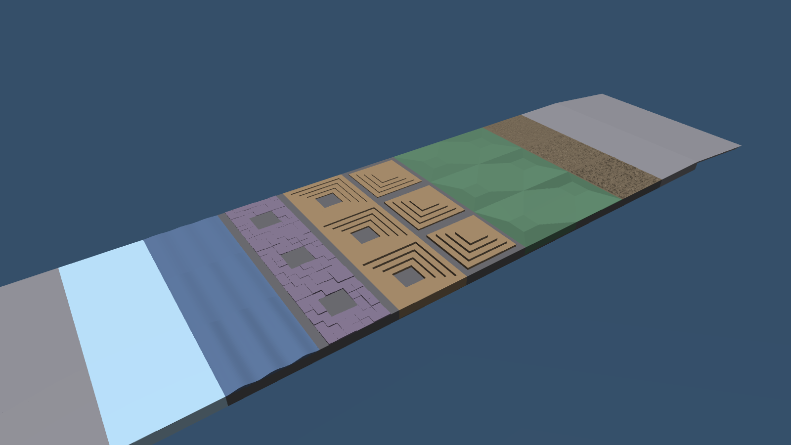

# Terrain test course for mc_mujoco

A static MuJoCo scene with mjlab-style terrains, for testing a trained policy
in mc_mujoco (no training). It is loaded as an mc_mujoco **object**, so the
default `env/ground` plane stays in place and the robot starts on it.



## Layout

- The course starts with a 6 m ramp at x = 1 m (about 5°) up to a 0.57 m high plateau.
- Tiles are 4 m long along +x, starting at x = 7 m:
  flat, rough, slope up, slope down, stairs up, stairs down, random blocks,
  waves, slippery (low friction), flat.
- One lane per difficulty along +y: easy (y = 0), medium (y = 4), hard (y = 8).
- Every tile border is at the plateau height, so the robot can walk straight
  through a whole lane.

| Level  | Rough | Slope | Step height | Blocks | Waves | Slippery µ |
|--------|-------|-------|-------------|--------|-------|-----------|
| easy   | 3 cm  | 5.7°  | 5 cm        | 3 cm   | 3 cm  | 0.5       |
| medium | 5 cm  | 11.5° | 9 cm        | 5 cm   | 6 cm  | 0.35      |
| hard   | 8 cm  | 17.2° | 13 cm       | 8 cm   | 10 cm | 0.2       |

Treads are 35 cm deep. Edit `LEVELS` and the constants at the top of
`generate_terrain_course.py` to match your robot, then regenerate.

## Option A: no rebuild (quickest)

1. Copy `terrain_course.xml` anywhere, e.g. `~/mc_mujoco_scenes/terrain_course.xml`.
2. Create `~/.config/mc_rtc/mc_mujoco/terrain_course.yaml`:
   ```yaml
   xmlModelPath: "/home/<you>/mc_mujoco_scenes/terrain_course.xml"
   ```
   mc_mujoco looks for `<module>.yaml` in this user folder before the install folder.
3. Add the object to `~/.config/mc_rtc/mc_mujoco/mc_mujoco.yaml` (see `mc_mujoco.yaml` here).
4. Run `mc_mujoco` as usual.

## Option B: install it with mc_mujoco

1. Copy `terrain_course.xml` and `terrain_course.in.yaml` into `mc_mujoco/robots/`.
2. Add this line at the end of `mc_mujoco/robots/CMakeLists.txt`:
   ```cmake
   setup_env_object(terrain_course object)
   ```
3. Rebuild and install (`cmake --build build && cmake --install build`).
4. Add the object to `~/.config/mc_rtc/mc_mujoco/mc_mujoco.yaml` (see `mc_mujoco.yaml` here).

## Testing one tile directly

Instead of walking the whole lane, teleport the robot from your controller with
the datastore callback mc_mujoco provides:

```cpp
// e.g. hard lane (y = 8), stairs up tile (x = 25); plateau height is 0.57 m
sva::PTransformd pose(Eigen::Vector3d(23.2, 8.0, 0.57 + standing_base_height));
datastore().call("<robot_name>::SetPosW", pose);
```

Spawn on the flat border strip of a tile (about 1.8 m before its centre),
not on top of a feature. Tile centres are printed when you run the generator.

## Regenerating

```bash
python3 generate_terrain_course.py                       # all three lanes
python3 generate_terrain_course.py --levels medium hard   # pick lanes
python3 generate_terrain_course.py --seed 3               # new random rough/blocks
python3 generate_terrain_course.py --x-start 3            # move the ramp start
```

Only numpy is needed. Heightfields are stored inline (`elevation`), so the XML
has no external files.
